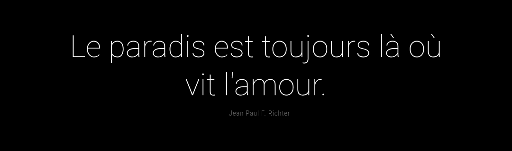

# MMM-QuoteOuns

Module [MagicMirror²](https://magicmirror.builders) qui affiche des citations depuis la [Quote API](https://quote-ouns.vercel.app) : 14 langues, plus de 250 catégories, et une mise en page qui s'adapte à la région où vous le placez.



- **Aucune dépendance**, aucune tâche planifiée : le module interroge l'API lui-même.
- **Fonctionne hors ligne** : les dernières citations reçues sont gardées en cache et réaffichées au démarrage.
- **S'adapte à sa position** : coin, centre, barre ou plein écran, en paysage comme en portrait.
- **Auteur affiché à part**, en petit sous la citation.

## Installation

```sh
cd ~/MagicMirror/modules
git clone https://github.com/FabienBounoir/MMM-QuoteOuns.git
```

Pas de `npm install` nécessaire (Node 18 ou plus).

## Configuration

> **Le plus simple : le [générateur de configuration](https://quote-ouns.vercel.app/magicmirror).** Choisissez la langue, les catégories et la position, regardez l'aperçu, puis copiez le bloc à coller dans `config/config.js`.

Les langues disponibles sont listées sur [`/api/languages`](https://quote-ouns.vercel.app/api/languages), et les catégories d'une langue sur [`/api/categories?lang=fr`](https://quote-ouns.vercel.app/api/categories?lang=fr) (remplacez `fr` par la langue voulue).

```js
{
	module: "MMM-QuoteOuns",
	position: "middle_center",
	config: {
		lang: "fr",
		categories: ["motivation", "life", "gratitude"]
	}
}
```

| Option | Défaut | Description |
| --- | --- | --- |
| `lang` | `"fr"` | Langue des citations (`fr`, `en`, `es`, `de`, `ja`…). Liste : `/api/languages` |
| `categories` | `["motivation", "positivity", "happy", "life", "short-quotes"]` | Catégories mélangées. Liste par langue : `/api/categories?lang=fr` |
| `maxLength` | `"auto"` | Longueur maximale d'une citation, en caractères. `"auto"` choisit selon la position |
| `size` | `"auto"` | Taille du texte : `xsmall`, `small`, `medium`, `large`, `xlarge`. `"auto"` choisit selon la position |
| `showAuthor` | `true` | Affiche l'auteur sous la citation quand il est connu |
| `rotateInterval` | `30000` | Durée d'affichage d'une citation (ms) |
| `fetchInterval` | `3600000` | Fréquence de renouvellement des citations depuis l'API (ms) |
| `fadeSpeed` | `2000` | Durée du fondu entre deux citations (ms) |
| `apiUrl` | `"https://quote-ouns.vercel.app/api/quotes/random"` | Adresse de l'API |

## Positions

| Position | Alignement | Taille auto | Longueur auto |
| --- | --- | --- | --- |
| `top_left`, `bottom_left` | gauche, colonne étroite | `medium` | 100 |
| `top_right`, `bottom_right` | droite, colonne étroite | `medium` | 100 |
| `top_center`, `bottom_center` | centré | `medium` | 120 |
| `upper_third`, `middle_center`, `lower_third` | centré | `large` | 140 |
| `top_bar`, `bottom_bar` | centré, toute la largeur | `large` | 180 |
| `fullscreen_above`, `fullscreen_below` | centré au milieu de l'écran | `xlarge` | 220 |

Plusieurs instances peuvent cohabiter, par exemple une citation courte dans un coin et une autre langue au centre.

## Test

```sh
node test.js
```

## Licence

MIT
